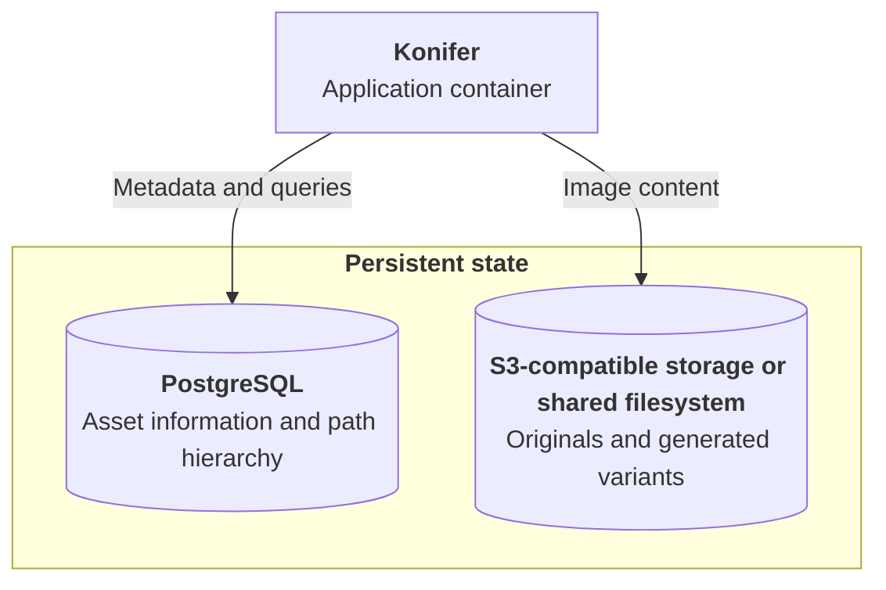

Konifer runs as a container with PostgreSQL for asset information and an object store for originals and generated variants.



## Storage requirements

Disable the quickstart's `IN_MEMORY` override to use persistent storage. `IN_MEMORY=true` overrides both configured
storage providers.

Enable `ltree` in the PostgreSQL database before starting Konifer:

```sql
CREATE EXTENSION IF NOT EXISTS ltree;
```

Konifer applies its bundled database migrations during startup. The application user needs read/write access and
permission to create and alter tables, indexes, and other schema objects.

Create every S3 bucket referenced by the path configuration. Konifer reads, writes, and deletes objects but does not
create buckets. Filesystem storage requires a persistent mount; instances using the same database must have access to
the same content at the configured mount path.

See [Storage Configuration](storage-configuration.md) for provider settings and credentials. The repository's
[Docker Compose example](https://github.com/dmaiken/konifer/blob/main/docker-compose.yml) runs Konifer with PostgreSQL
and MinIO.

## Container configuration

Use the [baseline configuration](../start-here/configure-konifer.md#start-with-a-small-configuration) and
[container command](../start-here/configure-konifer.md#where-configuration-belongs) in Configure Konifer.

- Image: `ghcr.io/dmaiken/konifer:{{koniferVersion}}`, available for Linux `amd64` and `arm64`.
- Configuration mount: `/app/config/konifer.conf`.
- HTTP port: `8080`.
- Credential overrides: `PG_USER`, `PG_PASSWORD`, `S3_SECRET_KEY`, and `URL_SIGNING_SECRET_KEY`.
  The signing secret applies when URL signing is enabled.

See the [Configuration reference](../reference/configuration-reference.md) for properties, defaults, and supported
environment variables.

Konifer exposes `/health/live` for HTTP liveness and `/health/ready` for application and dependency readiness. Both
return an empty body. See [Configure Health Probes](health-checks.md) for checks, refresh timing, and Kubernetes examples.

## Networking and delivery

Set `http.public-url` when the public origin differs from the scheme, host, and port Konifer sees on incoming requests:

```hocon
http {
  public-url = "https://images.example.com"
}
```

Konifer uses this origin for service delivery URLs and absolute asset `Location` headers. Without it, Konifer uses the
incoming request origin. It does not interpret forwarded headers to reconstruct the public origin.

Application authentication and authorization are external to Konifer. [URL signing](../reference/url-signing.md) applies
to asset fetch requests; it does not authenticate store, update, delete, or rule evaluation requests.

Upload limits use `source.multipart.max-bytes` and `source.url.max-bytes`. Content responses support ETags, with
`Cache-Control` configured by path; see [HTTP caching](../reference/http-caching.md). The path-level
[`delivery` settings](../reference/configuration-reference.md#delivery) select service, presigned, or template URLs.

## Processing resources and models

Image processing uses JVM heap, direct memory, native libvips memory, CPU, and temporary disk space at `/app/tmp`.
JVM memory limits do not cover native processing memory. See [Resource Tuning](resource-tuning.md) for memory settings,
temporary storage, worker concurrency, and scheduling.

Upload Rules and the Rule Evaluation API require a separate SigLIP2 model pack at:

```text
/app/models/siglip2-base-patch16-224
```

See [Installing model files](../concepts/upload-rules.md#installing-model-files). Model inference adds CPU and memory
requirements. Image storage and transformation alone do not require model files.

## Multiple instances

Replicas share the same PostgreSQL database and S3 buckets or filesystem content. Use the same configuration, secrets,
and model files across instances.

Konifer loads configuration at startup. Restart all instances after changing path rules, profiles, storage settings,
or URL signing configuration.

## Upgrades and stored state

PostgreSQL records refer to content in the object store. A restored deployment needs compatible database records,
object-store content, and configuration.

Konifer applies database migrations when the new version starts. Returning to an older container image does not reverse
those migrations; schema compatibility determines whether that version can use the upgraded database. See the
[release notes](https://github.com/dmaiken/konifer/releases) for version-specific changes.
